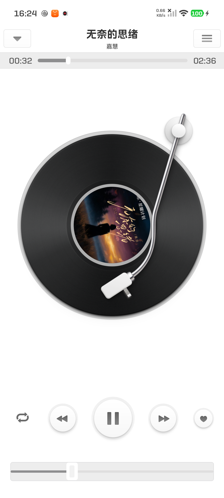
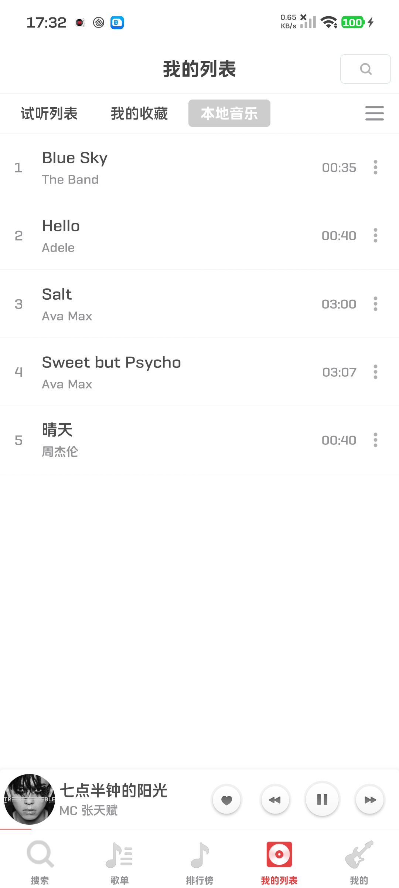

# 锤子音乐 · lx-music-SmartisanUI

> 基于 [lx-music-mobile](https://github.com/lyswhut/lx-music-mobile)（洛雪音乐移动版，React Native）二次开发的**锤子（Smartisan）风格**改版。
> 保留洛雪音乐全部核心能力（多音源搜索、歌单/排行榜、自定义音源、歌词、下载、同步等），整体界面按锤子音乐播放器的视觉语言重绘。

<p align="center">
  
  
  
</p>

## 特点

- **锤子视觉体系**：主红 `#E64040`、正文 `#4d4d4d`、次要 `#939396`、发丝线 `#ededed`、页面底 `#f2f2f2`、分段选中 `#cdcdcd`；描边按钮、居中标题栏、A–Z 字母索引、黑胶唱机播放页、遮罩歌词页。
- **完整洛雪内核**：在线搜索、歌单、排行榜、我的列表、本地音乐、播放队列、歌词、自定义音源（userApi）、数据备份与同步、定时停止播放等。
- **锤子式播放器**：黑胶唱片 + 唱臂、逐行高亮的歌词页、底部迷你播放条（白色圆形四按钮 + 底部红色进度线）。
- **我的**：品牌区 + 收藏 / 本地音乐 / 播放历史 / 定时停止 / 自定义源管理 / 关于 / 设置入口。
- **锤子风格操作弹层**：列表每首歌的「更多」改为底部四列图标栅格弹层。

## 与上游的关系

本项目以 `lx-music-mobile` 为底座进行 UI 层改造，**不改动洛雪音乐的核心播放与音源逻辑**。
在线播放能力依赖自定义音源（洛雪自 v1.9 起已下线内置音源），请在「设置 → 自定义源管理」中导入可用的音源脚本后再播放在线歌曲。

- 上游项目：<https://github.com/lyswhut/lx-music-mobile>
- 上游文档：<https://lyswhut.github.io/lx-music-doc/mobile/>
- 视觉参考：Smartisan Music Player（仅借鉴交互与视觉，不含其代码/资源）

## 技术栈

- React Native 0.73 + TypeScript
- Redux（状态管理）
- Android 5.0 及以上

## 构建

```bash
# 依赖（如遇网络受限，可将 github 依赖换成本地 tarball）
npm install

# 开发（Metro）
npm start

# 打包 Debug APK
cd android
./gradlew :app:assembleDebug -PreactNativeArchitectures=arm64-v8a
# 产物: android/app/build/outputs/apk/debug/lx-music-mobile-v1.0.0-arm64-v8a.apk

# 发布包（签名同 debug.keystore）
./gradlew :app:assembleRelease -PreactNativeArchitectures=arm64-v8a
# 产物: android/app/build/outputs/apk/release/lx-music-mobile-v1.0.0-arm64-v8a.apk
```

构建前需准备 `android/keystore.properties`（指向 `debug.keystore`），并设置 `JAVA_HOME` 为 JDK 17。

## 声明

- 本项目仅供学习与个人使用，所有音乐资源均来自第三方音源，本项目不存储、不传播任何音频内容。
- 请支持正版音乐。因使用本软件产生的任何后果由使用者自行承担。
- 上游 `lx-music-mobile` 采用 Apache-2.0 协议；本项目在遵守其协议的前提下进行。

## 致谢

- [lx-music-mobile](https://github.com/lyswhut/lx-music-mobile) — 底座与全部音乐能力
- Smartisan Music Player — 视觉与交互灵感
